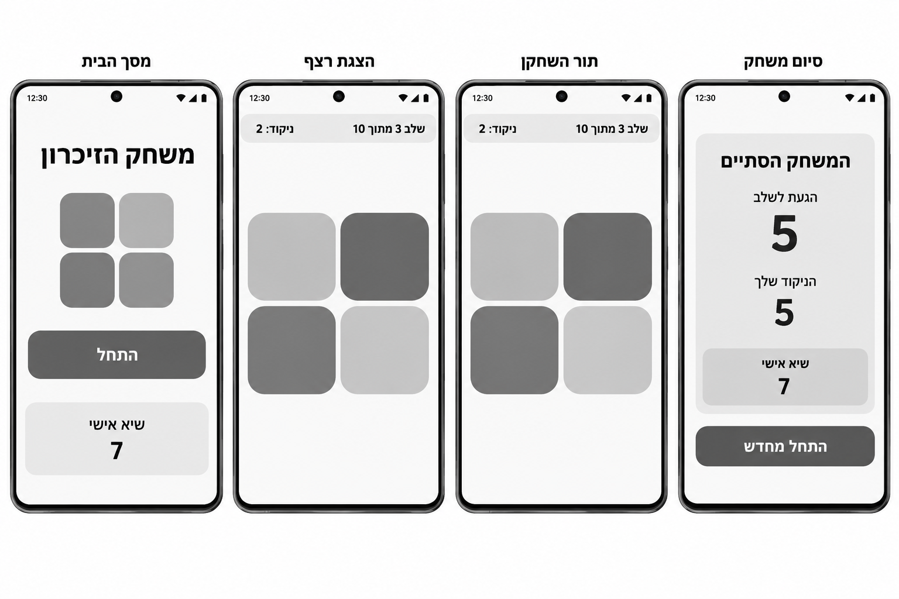
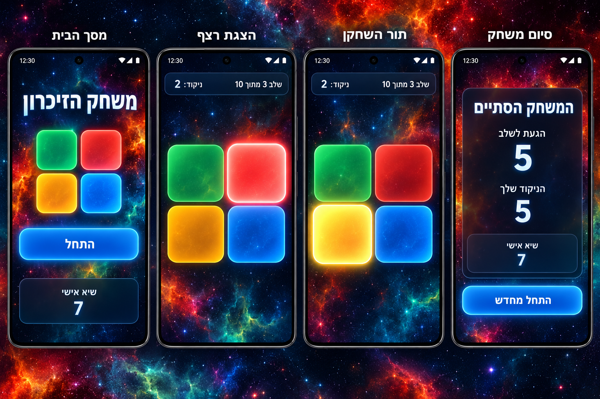
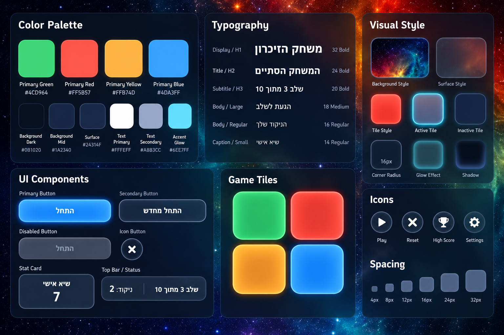

# DESIGN — משחק Simon

מסמך זה מגדיר את מימוש הממשק החזותי על בסיס ה-PRD, ה-Wireframes, ה-Style Guide וה-Mockups. המוצר מיועד לטלפון Android ב-Chrome, עם ממשק עברי בכיווניות RTL.

## 1. Screens — מסכי האפליקציה

**הבחנה חשובה בין מסכים למצבים:** בהתאם ל-PRD קיימים **שני מסכים בלבד**: בית/משחק ואודות. ארבעת הייצוגים ב-Wireframes וב-Mockups הם ארבעה **מצבים של מסך הבית/המשחק** — מצב התחלתי, הצגת רצף, תור השחקן וסיום משחק — ולא ארבעה מסכי ניווט עצמאיים. מסך אודות נדרש ב-PRD אך אינו מופיע בתמונות, ולכן מבנהו יתואר על פי ה-PRD בלבד, ללא ייחוס עיצוב מפורט שלא הודגם.

**המספרים בתמונות להמחשה בלבד:** ערכי השלב, הניקוד והשיא בתמונות אינם תואמים בהכרח את חוקי הניקוד (למשל "שלב 3, ניקוד 2" או "הגעת לשלב 5, הניקוד שלך 5"). הערכים בפועל נקבעים לפי ה-PRD.

**סרגל עליון:** בכל מצבי מסך הבית/המשחק מוצגת בראש המסך שורה עם שני כפתורי אייקון עגולים וקטנים (ראו Icon Buttons ב-2.3): כפתור **"אודות"** (אייקון מידע "i") בפינה הימנית העליונה, וכפתור **השתקה/ביטול השתקה** (אייקון רמקול / רמקול מושתק) בפינה השמאלית העליונה. השורה ממוקמת מעל הכותרת או מעל פס השלב והניקוד, ואינה זזה בין המצבים. לכל כפתור שם נגיש בעברית ("אודות", "השתק צלילים" / "הפעל צלילים").

### 1.1 בית / משחק — מצב התחלתי

- **מטרה:** לאפשר להתחיל משחק זיכרון חדש.
- **מבנה ותוכן:** פריסה אנכית בתוך Viewport של Smartphone. כותרת מרכזית "משחק הזיכרון", ללא פס שלב וניקוד (הפס מחליף את הכותרת מרגע הלחיצה על "התחל"); מתחתיה ארבעה אריחי צבע גדולים ומעוגלים ב-Grid של 2×2; מתחת ללוח כפתור ראשי רחב "התחל". ה-Mockup מציג כרטיס "שיא אישי" בתחתית, אך לפי ה-PRD הצגת השיא מחויבת במסך אודות בלבד; אין לראות בכרטיס שב-Mockup אישור להוספת רכיב זה למסך הבית.
- **פעולות וניווט:** "התחל" מפעיל את המשחק. כפתורי "אודות" והשתקה נמצאים בסרגל העליון (ראו לעיל).

### 1.2 בית / משחק — הצגת רצף

- **מטרה:** להמחיש לשחקן את הרצף שעליו לזכור.
- **מבנה ותוכן:** בחלק העליון פס סטטוס כהה ומעוגל המציג שלב מתוך 10 וניקוד מצטבר, ב-RTL. במרכז לוח 2×2 מוגדל; אריח פעיל מודגש באמצעות הארה חזקה יותר ו-Glow בצבעו. יתר האריחים נותרים גלויים אך פחות מוארים. הרקע ממשיך את מראה החלל.
- **פעולות וניווט:** האריחים אינם לחיצים בזמן הצגת הרצף. מעבר לתור השחקן מתבצע באותו מסך, ללא ניווט וללא כפתור נוסף.

### 1.3 בית / משחק — תור השחקן

- **מטרה:** לאפשר שחזור של רצף הצבעים.
- **מבנה ותוכן:** אותו פס שלב וניקוד ואותו לוח 2×2, ללא שינוי מיקום בין המצבים. האריח שנלחץ מקבל הדגשת Glow רגעית; המשוב החזותי אינו תלוי בשמע.
- **פעולות וניווט:** לחיצה על אריחי הצבע; מעבר אוטומטי לרצף הבא לאחר הצלחה, או למצב סיום לאחר שגיאה. אין הנחיות טקסטואליות מתחלפות בזמן הצגת הרצף או שחזורו.

### 1.4 בית / משחק — סיום משחק

- **מטרה:** להציג תוצאה ולאפשר ניסיון חדש.
- **מבנה ותוכן:** כרטיס כהה ומעוגל במרכז המסך, עם כותרת סיום, שני ערכים בולטים וכפתור ראשי בתחתית. בדומה ל-Mockup, מוצגים **"הגעת לשלב"** עם מספר השלב שבו נעשתה הטעות, ומתחתיו **"הניקוד שלך"** עם הניקוד המצטבר. ה-Mockup מציג את הכותרת "המשחק הסתיים" ואת הכפתור "התחל מחדש", אולם נוסחי ה-PRD המחייבים הם **"המשחק נגמר"** ו-**"משחק חדש"**. יש להשתמש בנוסחי ה-PRD. כרטיס "שיא אישי" המופיע בתמונת ההשראה **אינו מוצג** במסך זה; השיא מוצג במסך אודות בלבד.
- **פעולות וניווט:** "משחק חדש" מחזיר למצב משחק חדש באותו מסך.
- **מצב ניצחון:** משתמש באותו כרטיס תוצאה לאחר שלב 10, עם הכותרת **"ניצחת!"**, אנימציית חגיגה, "הניקוד שלך" 55 וכפתור "משחק חדש"; ללא שורת "הגעת לשלב". זהו מצב של המסך הקיים, לא מסך נוסף. סגנון האנימציה לא פורט בתמונות ולכן אינו נקבע כאן.

### 1.5 אודות

- **מטרה:** לספק הסבר קצר על המשחק, הוראות, כללי ניקוד ושיא אישי.
- **מבנה ותוכן:** כותרת "אודות", אזורי טקסט בעברית עבור תיאור המשחק, הוראות המשחק וכללי הניקוד, ואזור המציג "שיא אישי". יש ליישם את שפת ה-Surface, הטיפוגרפיה, הפינות והמרווחים המוגדרים להלן, אך אין מקור חזותי שמכתיב פריסה מפורטת למסך זה.
- **פעולות וניווט:** כפתור "חזרה למשחק" מחזיר למסך הבית. אין סרגל ניווט קבוע.

### 1.6 ניווט כללי

הניווט היחיד בין מסכים הוא **בית/משחק ↔ אודות**. מצבי ההתחלה, הצגת הרצף, תור השחקן, כישלון וניצחון מתקיימים בתוך מסך הבית/המשחק. אין להוסיף מסכי ניווט נוספים על סמך כותרות המצבים המופיעות מעל הטלפונים בתמונות; אלו תוויות הסבר בלוח ההדמיה, לא כותרות שיש להציג בזמן המשחק.

## 2. Style Guide — השפה העיצובית

### 2.1 Color Palette

| Token | HEX | שימוש |
|---|---|---|
| Primary Green | `#4CD964` | אריח ירוק |
| Primary Red | `#FF5B57` | אריח אדום |
| Primary Yellow | `#FFB74D` | אריח צהוב |
| Primary Blue | `#4DA3FF` | אריח כחול; בסיס להדגשת כפתור ראשי |
| Background Dark | `#0B1020` | רקע כהה מתחת למרקם החלל |
| Background Mid | `#1A2340` | מעבר צבע/שכבת רקע משנית |
| Surface | `#24314F` | כרטיסים, פסי סטטוס וכפתורים משניים |
| Text Primary | `#FFFFFF` | כותרות, ערכים וטקסט ראשי |
| Text Secondary | `#A8B3CC` | טקסט משני ותוויות |
| Accent Glow | `#6EE7FF` | הארות ודגשים זוהרים |

הצבעים לעיל מועתקים מהתוויות ב-Style Guide. אין להחליף את ארבעת צבעי המשחק בצבעים אחרים. בתמונת ה-Mockups הם מופיעים בהירים ורוויים יותר בשל הארה, Gradient ו-Glow; אלה מצבי תצוגה של אותם צבעים, ולא צבעי בסיס חדשים.

### 2.2 Typography

- **גופן:** **Heebo** בכל הממשק — Sans-serif מודרני, עבה וברור בכותרות, עם קריאות גבוהה על רקע כהה ותמיכה מלאה בעברית. הגופן נשמר בתוך הפרויקט (ראו ARCHITECTURE.md), עם גופן מערכת Sans-serif כגיבוי.
- **Display / H1:** `32px`, `Bold` — כותרת ראשית כגון "משחק הזיכרון".
- **Title / H2:** `24px`, `Bold` — כותרת מצב סיום.
- **Subtitle / H3:** `20px`, `Bold` — תצוגת שלב.
- **Body / Large:** `18px`, `Medium` — תוויות תוצאה בולטות.
- **Body / Regular:** `16px`, `Regular` — הוראות וטקסט רגיל.
- **Caption / Small:** `14px`, `Regular` — תוויות משניות כגון "שיא אישי".
- **ערכי תוצאה:** במצב סיום המספרים גדולים משמעותית מטקסט הגוף, בהתאם ל-Mockup; גודל מדויק לא הוגדר במקור.

### 2.3 UI Style

- **אריחי המשחק:** ארבעה אריחים ריבועיים כמעט לחלוטין, עם פינות מעוגלות מאוד, מרווח אחיד וגבול צבעוני דק. מצב רגיל כולל מילוי רווי ו-Glow מתון; מצב פעיל כולל Glow בולט ובהירות מוגברת. הסדר **כפי שנראה בתמונות** הוא ירוק בשמאל העליון, אדום בימין העליון, צהוב בשמאל התחתון וכחול בימין התחתון; זהו סדר האריחים החזותי שיש לשמר, בלי להפוך את ה-Grid אוטומטית בגלל RTL.
- **Primary Button:** מלבן רחב עם פינות מעוגלות, מילוי כחול בוהק, טקסט לבן Bold, מסגרת והארת Glow כחולה. דוגמאות: "התחל", "משחק חדש".
- **Secondary Button:** Surface כחול-כהה, קו מתאר בהיר, טקסט לבן; מתאים לפעולות משניות כגון "חזרה למשחק".
- **Disabled State:** Surface אפור-כחול, טקסט מוחלש וללא הארה בולטת. במהלך הצגת רצף יש להבחין בין אריח מואר לצורכי הדגמה לבין מצב שבו קלט השחקן חסום.
- **Cards / Status:** רקע כהה-שקוף או כחול-כהה, פינות מעוגלות, גבול דק ובהיר. פס השלב והניקוד ממוקם מעל הלוח ומחולק לשני אזורי תוכן.
- **Icon Buttons:** עיגול כהה עם גבול דק ואייקון לבן פשוט. משמשים לשני כפתורי הסרגל העליון בלבד: אייקון רמקול / רמקול מושתק להשתקה, ואייקון מידע "i" ל"אודות"; אין להוסיף פעולות כמו Settings, Trophy או Reset רק מפני שהן מופיעות כדוגמאות אייקונים ב-Style Guide.
- **Input Fields / Menus:** אינם חלק מהמסכים שאושרו. אין צורך לעצב או לממש אותם.

### 2.4 Visual Style

- **אווירה:** Cosmic — רקע חלל מצויר בגווני כחול כהה וטורקיז, עם כוכבי לכת, גבישים זוהרים, נוף סלעי וכוכבים, בהשראת תמונה שסיפק המשתמש (ראו Imagery). הרקע עשיר אך רכיבי המשחק נותרים ברורים מעליו. ערפילית כתומה-אדומה שמופיעה ב-Mockups וב-Style Guide הוחלפה ברקע זה; שאר השפה העיצובית (צבעים, אריחים, כפתורים, Surface) לא השתנתה.
- **Surface Treatment:** שכבות כהות בסגנון Glass-like, עם שקיפות עדינה, קו מתאר דק והפרדה מהרקע באמצעות ניגודיות וצל.
- **Shapes & Radius:** אריחי המשחק וכרטיסי התוכן בעלי פינות מעוגלות. דוגמת Corner Radius ב-Style Guide היא `16px`; יש לראות בה ערך בסיס לרכיבים, בעוד שה-Mockups מציגים עיגול מורגש במיוחד באריחים ובכפתורים.
- **Borders & Shadows:** מסגרות דקות ובהירות על Surface כהה; צללים רכים; Glow צבעוני סביב אריח פעיל וכפתור ראשי. אין להאיר את כל רכיבי המסך בעוצמה זהה.
- **Spacing:** סולם `4px`, `8px`, `12px`, `16px`, `24px`, `32px`. מרווחים קטנים בתוך רכיבים, גדולים בין אזורים; Grid האריחים סימטרי עם רווח קבוע.
- **Layout:** Mobile-First; אזור התוכן ממורכז לרוחב, עם שוליים צדדיים אחידים. כותרת/סטטוס בחלק העליון, לוח משחק במרכז, פעולות מתחתיו. אין להאריך את ה-Viewport או להוסיף גלילה למשחק הראשי רק כדי להציג עיטורים.
- **Imagery:** גרפיקת רקע אחת בלבד, ללא תמונות תוכן נוספות. הרקע **נבנה בקוד כגרפיקה וקטורית (SVG)** ולא מקובץ תמונה, כך שהוא חד בכל גודל מסך ונטען מהר. מרכיבים, מלמעלה למטה:
  - מעבר צבע אנכי מכחול-לילה כהה (Background Dark / Background Mid) בחלק העליון לטורקיז עמוק סביב שליש המסך התחתון, עם הילה בהירה עדינה מאחורי קו האופק.
  - כוכבים: נקודות לבנות ותכלכלות בגדלים ובשקיפויות שונים, וכמה כוכבים נוצצים בצורת "+" רכה.
  - שני-שלושה כוכבי לכת עגולים בגווני כחול-אפור עם הצללה פשוטה: אחד גדול שחתוך בפינה העליונה, ואחד-שניים קטנים.
  - כמה גבישים מצולעים זוהרים בטורקיז (Accent Glow) מפוזרים בשוליים.
  - צללית סלעית כהה ומחודדת בתחתית המסך.
  
  הסגנון מצויר ושטוח (Flat), עם Glow עדין בלבד. הרקע ממלא את כל המסך ונשאר קבוע מאחורי התוכן, והאזור המרכזי שמאחורי הלוח נשאר שקט יחסית כדי שהאריחים והטקסט יבלטו. מותר להוסיף שכבה כהה-שקופה עדינה מעל הרקע. אין אנימציה ברקע.
- **Consistency:** אותו גודל ומיקום של לוח 2×2 בין הצגת רצף לתור השחקן; אותו סגנון כרטיסים, תאורה וטיפוגרפיה בכל מצבי המשחק ובמסך אודות.

### 2.5 שפה וכיווניות

- **שפת הממשק:** עברית בלבד, `lang="he"`, `dir="rtl"`.
- **יישור:** טקסטים בעברית מיושרים בהתאם ל-RTL; כותרות מרכזיות ממורכזות. ערכי ניקוד ושלב צריכים להיות קריאים גם כאשר הם משולבים עם ספרות.
- **לוח הצבעים:** סדר האריחים נקבע לפי ה-Mockups ואינו מתהפך עם כיוון הטקסט.
- **טקסטים מחייבים:** נוסחי פעולות ותוצאות נקבעים לפי ה-PRD, גם כאשר ההדמיות מציגות ניסוח שונה. שמות המצבים שמעל תמונות הטלפונים אינם חלק מממשק המשחק.

### 2.6 גבולות המימוש החזותי

התמונות מציגות ארבעה מצבי משחק בלבד ואינן מדגימות את מסך אודות, את כפתור ההשתקה ואת כפתור המעבר ל"אודות". מיקום שני הכפתורים נקבע בסרגל העליון (סעיף 1), ומסך אודות ימומש לפי ה-PRD ובאותה שפה עיצובית. הצגת "שיא אישי" במסך הבית ובסיום המשחק מופיעה בהדמיות, אך הוחלט שהשיא מוצג **במסך אודות בלבד**, כמו ב-PRD. המסמך אינו מוסיף מסכים, תפריטים או יכולות חדשות.
